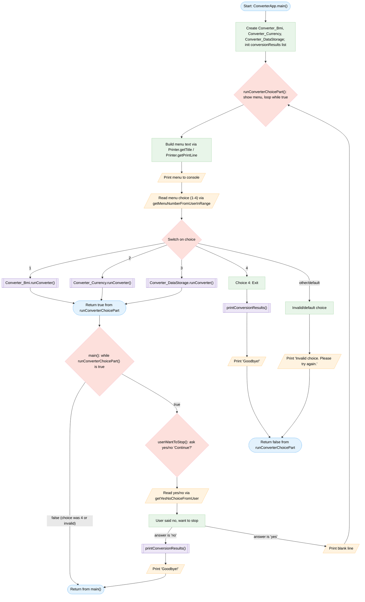
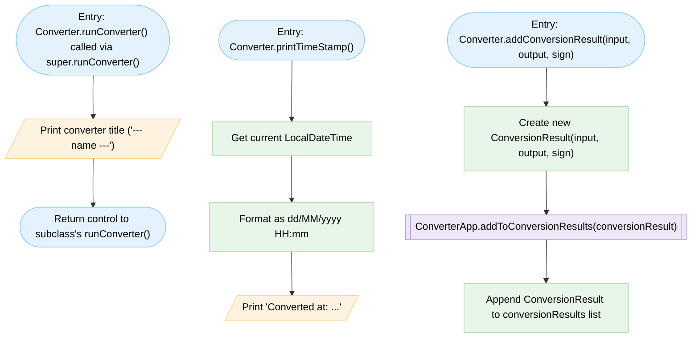
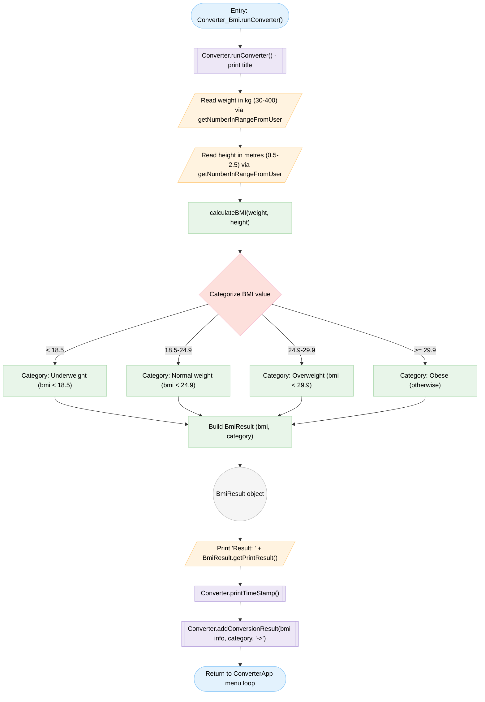
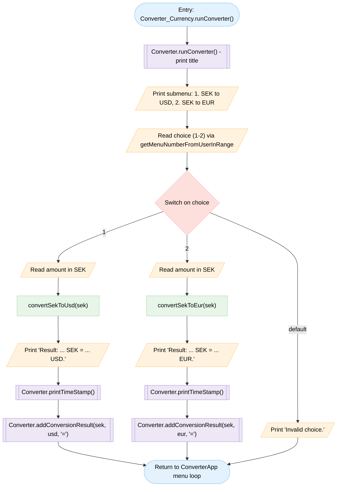
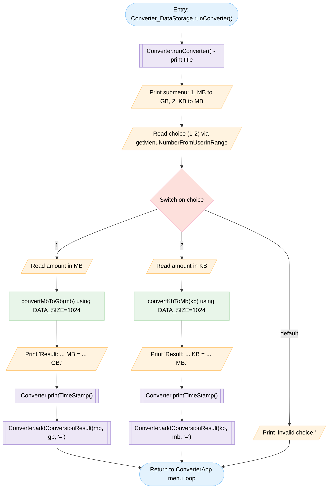
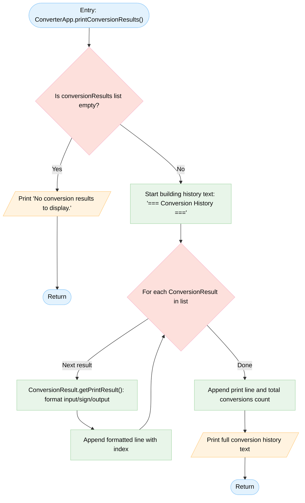

# Flowchart: ConverterApp (combined architecture)

This chart shows the combined control flow of `ConverterApp`, its menu loop, shared input/validation helpers, the `Printer` utility, and how it dispatches to each `Converter` subclass (`Converter_Bmi`, `Converter_Currency`, `Converter_DataStorage`) through the shared `Converter` base class, including the `BmiResult` and `ConversionResult` objects produced along the way.

## Main Flow: ConverterApp.main() and menu loop

## Flow: Converter base class and shared helpers

## Flow: Converter_Bmi.runConverter()

## Flow: Converter_Currency.runConverter()

## Flow: Converter_DataStorage.runConverter()

## Flow: printConversionResults() - shared output of history

## Legend

| Shape | Class | Meaning |
|---|---|---|
| Stadium `([ ])` | `term` | Start / end / return |
| Parallelogram `[/ /]` | `io` | Console input/output (read/print) |
| Rectangle `[ ]` | `proc` | Processing: calculation, assignment, formatting |
| Rhombus `{ }` | `dec` | Decision: if/else, switch, loop condition |
| Subroutine `[[ ]]` | `pre` | Call to another charted method (e.g. a converter's `runConverter()`, `Converter.printTimeStamp()`) |
| Circle `(( ))` | `conn` | Connector / object marker (e.g. the `BmiResult` instance) |
| (none shown) | `hide` | Invisible spacer, unused here |
| (none shown) | `label` | Free text annotation, unused here |
